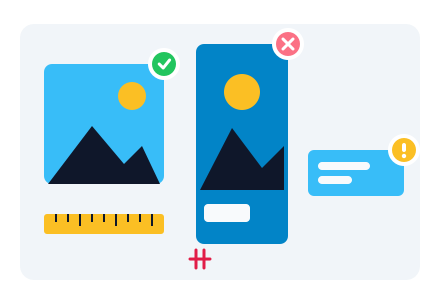
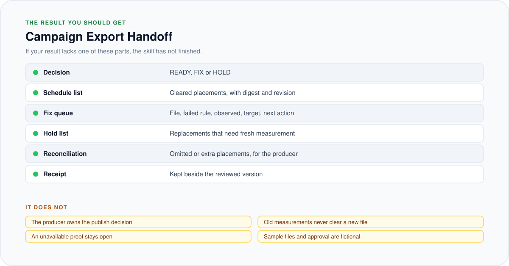

# Campaign Export Handoff

> Which placement ships, who fixes what, what needs re-measuring.

**Price:** $29 one-time, as shown on the listing on 24 November 2026.  
**Listing:** https://www.agensi.io/skills/campaign-export-handoff  
**Whiteboard:** https://claude.ai/artifact/45oYpTyoCB4AXbL6AGTvEB (private Claude whiteboard; the owner shares access)

## What it does and how it acts

## One sample run

Source: the bundled fictional sample. This shows how the skill acts. It is not a customer result.

## The result you should get

## It does not

- The producer owns the publish decision
- Old measurements never clear a new file
- An unavailable proof stays open
- Sample files and approval are fictional

[Back to all paid skills](../README.md)
