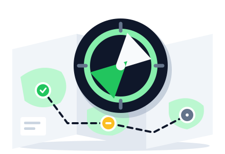
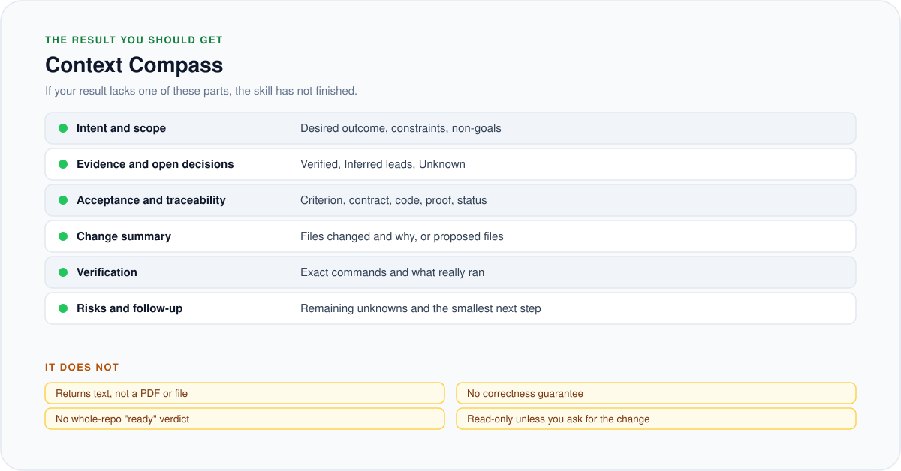

# Context Compass: Repo Prep & Proof-Driven Changes

> Trace each requested behavior to proof before you edit.

**Price:** $9 one-time, as shown on the listing on 24 November 2026.  
**Listing:** https://www.agensi.io/skills/context-compass-repo-prep-proof-driven-changes  
**Whiteboard:** https://claude.ai/artifact/Q7ox87aqjVyuTiKhb9VoHJ (private Claude whiteboard; the owner shares access)

## What it does and how it acts

## One sample run

Source: a local, internal example in this repository. This shows how the skill acts. It is not a customer result.

## The result you should get

## It does not

- Returns text, not a PDF or file
- No correctness guarantee
- No whole-repo "ready" verdict
- Read-only unless you ask for the change

[Back to all paid skills](../README.md)
