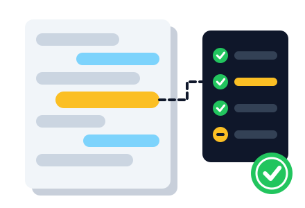
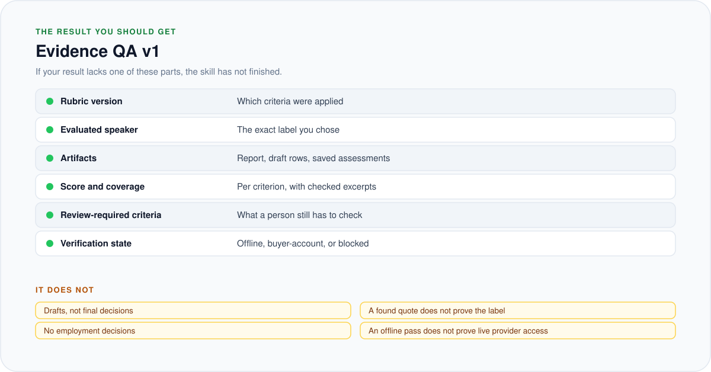

# Evidence QA v1: Conversation Reviews with Checked Quotes

> Score conversations on your rubric, with every quote checked.

**Price:** $59 one-time, as shown on the listing on 24 November 2026.  
**Listing:** https://www.agensi.io/skills/evidence-qa-v1-conversation-reviews-with-checked-quotes  
**Whiteboard:** https://claude.ai/artifact/FdG5MfNhevoTqK2Xk5jaqU (private Claude whiteboard; the owner shares access)

## What it does and how it acts

## One sample run

Source: the bundled synthetic demo. This shows how the skill acts. It is not a customer result.

## The result you should get

## It does not

- Drafts, not final decisions
- A found quote does not prove the label
- No employment decisions
- An offline pass does not prove live provider access

[Back to all paid skills](../README.md)
