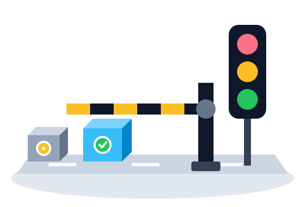
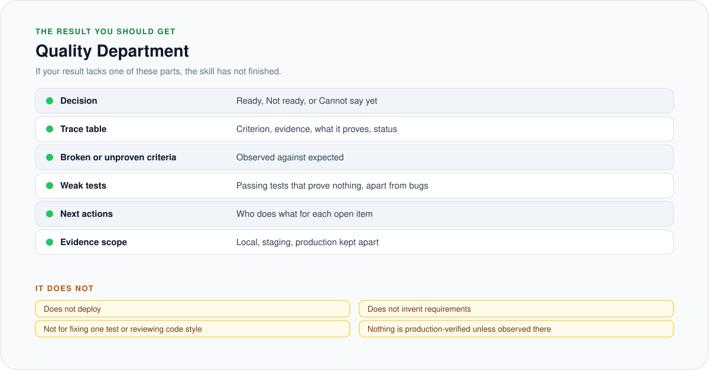

# Quality Department — Idea to Production QA

> A go or no-go you can defend, criterion by criterion.

**Price:** $69 one-time, as shown on the listing on 24 November 2026.  
**Listing:** https://www.agensi.io/skills/quality-department-idea-to-production-qa  
**Whiteboard:** https://claude.ai/artifact/Mow3RdjkNwkwm3GQxm3QE7 (private Claude whiteboard; the owner shares access)

## What it does and how it acts

## One sample run

Source: the bundled synthetic lab. This shows how the skill acts. It is not a customer result.

## The result you should get

## It does not

- Does not deploy
- Does not invent requirements
- Not for fixing one test or reviewing code style
- Nothing is production-verified unless observed there

[Back to all paid skills](../README.md)
