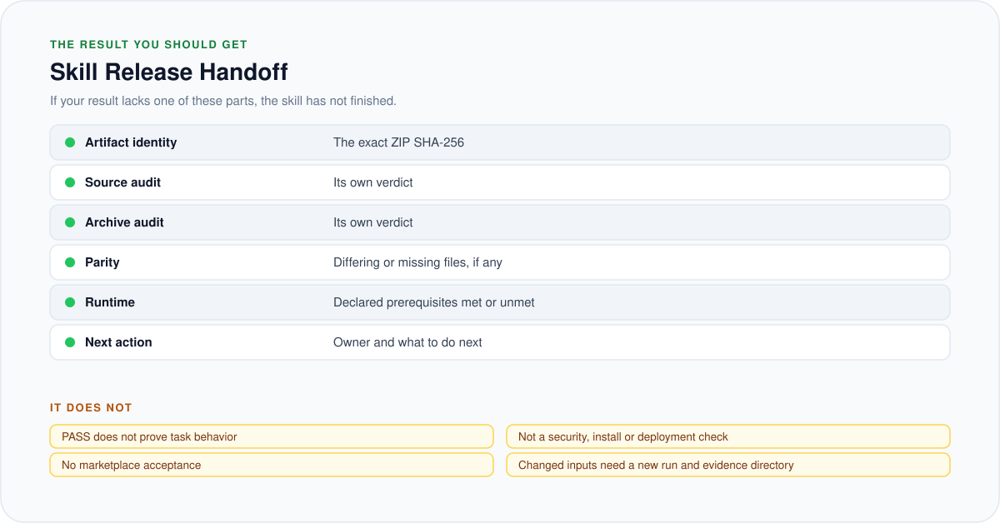

# Skill Release Handoff — Check the ZIP You Send

> Check the exact ZIP the recipient gets, not the folder.

**Price:** $19 one-time, as shown on the listing on 24 November 2026.  
**Listing:** https://www.agensi.io/skills/skill-release-handoff-check-the-zip-you-send  
**Whiteboard:** https://claude.ai/artifact/5UzpJe5khngdCnYwPKxHQD (private Claude whiteboard; the owner shares access)

## What it does and how it acts

## One sample run

Source: an illustrative case, not a recorded run. This shows how the skill acts. It is not a customer result.

## The result you should get

## It does not

- PASS does not prove task behavior
- Not a security, install or deployment check
- No marketplace acceptance
- Changed inputs need a new run and evidence directory

[Back to all paid skills](../README.md)
