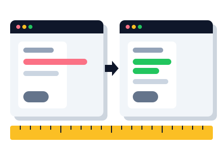
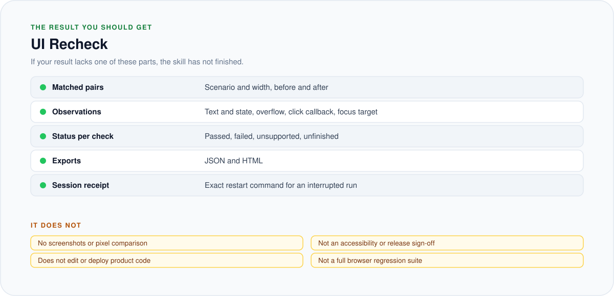

# UI Recheck — Before & After

> Same states, same widths, before and after, measured.

**Price:** $19 one-time, as shown on the listing on 24 November 2026.  
**Listing:** https://www.agensi.io/skills/ui-recheck-before-after  
**Whiteboard:** https://claude.ai/artifact/NCJv8SEHefzp6b3yH3uVGJ (private Claude whiteboard; the owner shares access)

## What it does and how it acts

## One sample run

Source: the bundled synthetic example. This shows how the skill acts. It is not a customer result.

## The result you should get

## It does not

- No screenshots or pixel comparison
- Not an accessibility or release sign-off
- Does not edit or deploy product code
- Not a full browser regression suite

[Back to all paid skills](../README.md)
